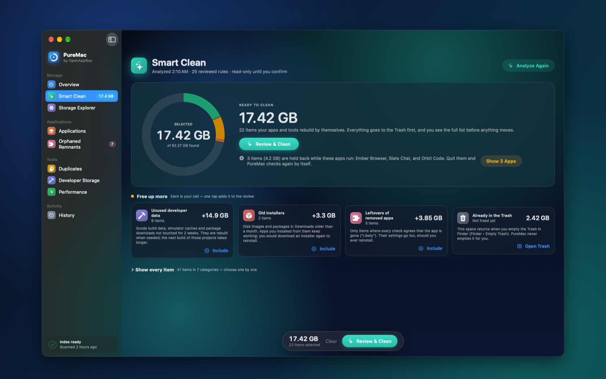
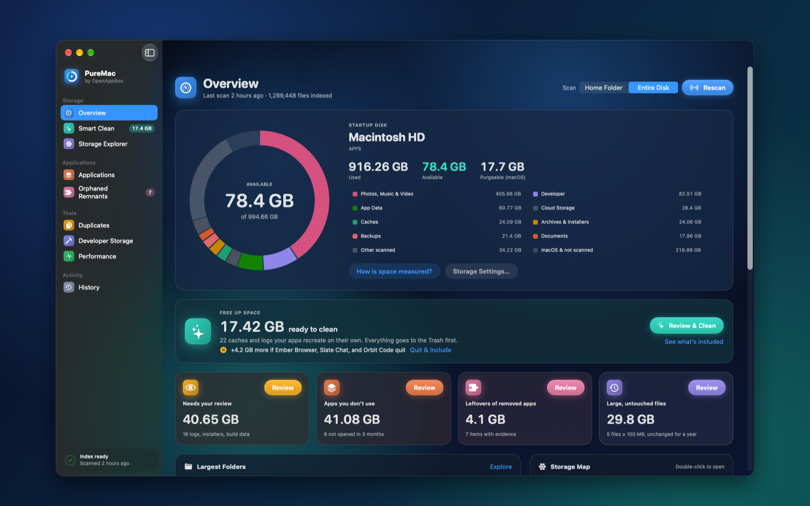
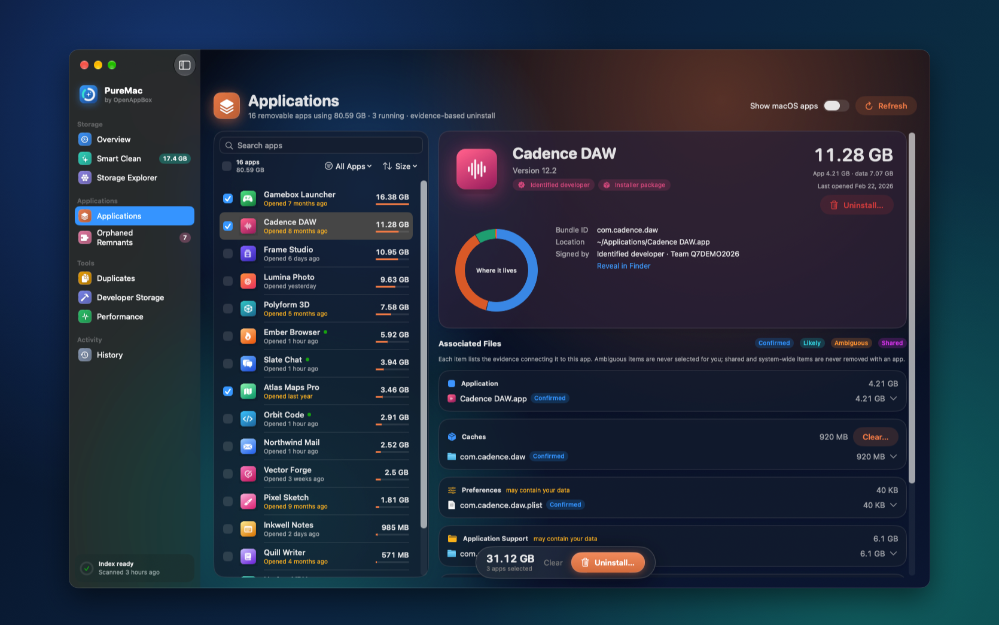
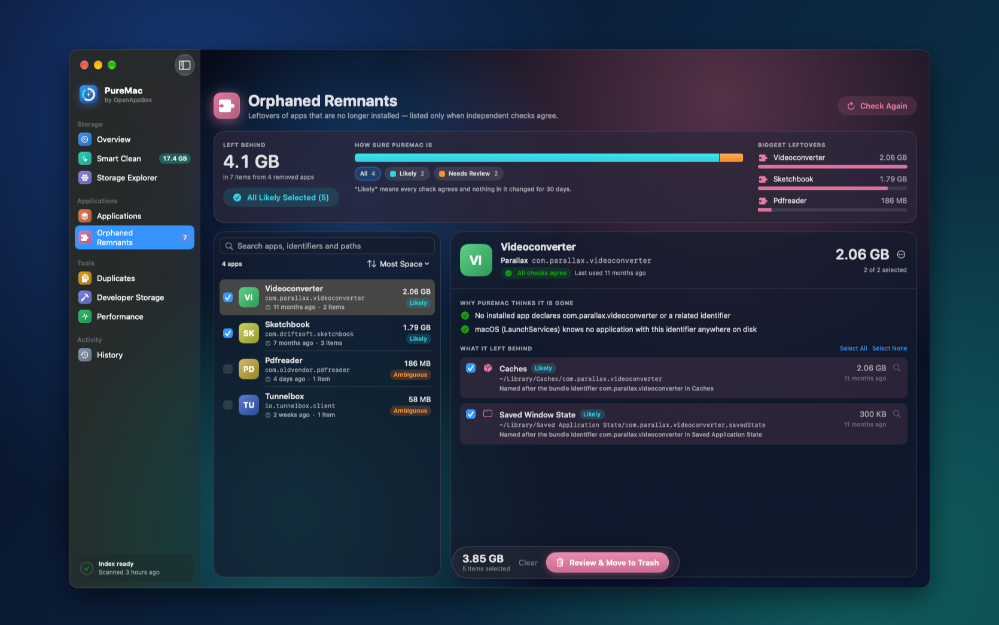
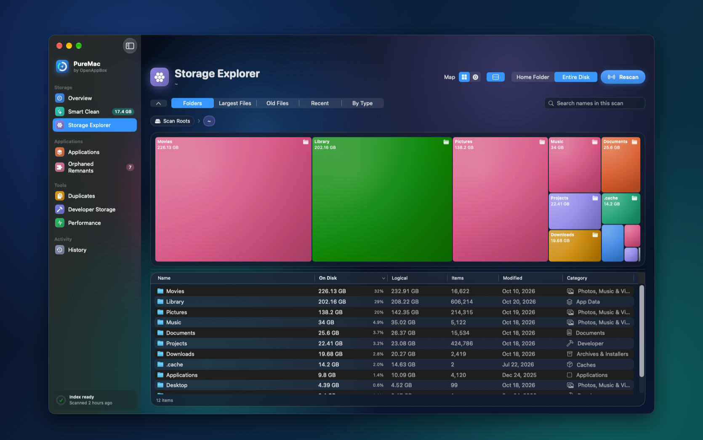

<div align="center">


# PureMac

### See what's filling your Mac. Free it up safely.

PureMac shows exactly what fills your Mac and frees space with one safe decision —<br>
every item previewed, everything moved to the Trash, nothing ever sent off your Mac.

[](#get-puremac)
[](#get-puremac)
[](LICENSE)
[](PRIVACY.md)
[](#speaks-your-language)

[**Website**](https://www.openappbox.com/puremac) ·
[**Get PureMac**](#get-puremac) ·
[**What's new**](CHANGELOG.md) ·
[**Report a bug**](https://github.com/OpenAppBox/PureMac/issues/new/choose)

<br>



</div>

---

## Your Mac is full. PureMac shows you why.

"Your disk is almost full." Then what? Delete things by hand and hope they weren't important? Or
trust a cleaner that promises gigabytes and won't tell you what it removes?

PureMac takes a different path. It maps your storage in seconds, picks only what your Mac rebuilds
by itself, and asks you for **one decision**. Everything it suggests is explained. Everything it
removes goes to the **Trash**, where you can put it back. And nothing — not a file name, not your app
list — ever leaves your Mac.

<table>
<tr>
<td width="33%" valign="top">

### ✨ One click, real space
Smart Clean has already done the thinking when you open it. One total, one button.

</td>
<td width="33%" valign="top">

### 🔍 Every gigabyte explained
Storage maps, plain-language reasons and the evidence behind every suggestion.

</td>
<td width="33%" valign="top">

### 🛡️ Nothing lost, nothing shared
Review before every move, Trash only, Put Back anytime — and fully offline.

</td>
</tr>
</table>

---

## What PureMac does for you

### Smart Clean — gigabytes back, one decision

Open Smart Clean and the work is done. PureMac checks 25 carefully reviewed rules and chooses
only what your Mac recreates on its own: app and browser caches, caches of apps like code editors and
chat apps, downloaded app updates, developer tool caches, and logs nobody has touched in a month.

- **One total, one button.** Press Review & Clean, look over the list, confirm. That's it.
- **Apps you're using are respected.** Their caches are held back until you quit those apps — then PureMac adds them by itself.
- **Free up more, one tap at a time.** Unused developer data, installers older than a month and leftovers of deleted apps, each explained in one line.
- **Never chosen for you:** anything personal, anything that might matter, anything PureMac isn't sure about.

### Overview — your whole disk at a glance



How full is your disk, what's taking the space, and how much can you free right now? An interactive
storage ring answers all three, and shows what changed since your last scan. Scan your home folder or
your **entire disk** — the choice is right next to the Scan button.

### Applications — see what every app really costs you



Apps hide gigabytes in caches, settings and support folders. PureMac shows each app's **real size**
— the app plus everything it stores — and when you last opened it. Pick the apps you don't need and
uninstall them together, completely. Keep your personal data for a reinstall if you like, or clear
just an app's caches.

### Orphaned Remnants — leftovers of apps you already deleted



Dragging an app to the Trash leaves its data behind. PureMac groups those leftovers by the app they
came from and tells you **why it believes the app is gone**. A leftover is listed only when installed
apps, running processes, launch agents and macOS's own app registry all agree. Folders that might hold
personal data — messages, password vaults, game saves — are never marked "Likely".

### Storage Explorer — your storage, mapped



Explore your disk as a **treemap** or a **sunburst**, then drill into any folder. Switch to largest,
old, recent or by-type views to find what you forgot. Select anything and review moving it to the
Trash — the map updates instantly, no rescan needed.

### And more

| | |
|---|---|
| **Duplicates** | Byte-identical files, compared by size, fingerprint and SHA-256. Preview each copy, keep the one you want — one copy is always kept. |
| **Developer Storage** | Xcode data, simulators, npm, Homebrew, CocoaPods, Gradle, Cargo, pip and project `node_modules` — measured, explained, and selectable by age. |
| **Performance** | Memory, CPU, disk and thermal state straight from macOS, with health checks that show their evidence. No "RAM boosters". |
| **History & Put Back** | Every cleanup is recorded on your Mac before anything moves. Put items back one by one, or a whole cleanup at once. |

---

## Built to be trusted

**PureMac will never:**

- ❌ Delete anything without showing you first
- ❌ Permanently delete files — everything goes to the Trash
- ❌ Empty your Trash
- ❌ Run in the background, nag you with notifications or start at login
- ❌ Send your file names, app list or anything else off your Mac
- ❌ Show ads, ask for an account or ask for your administrator password
- ❌ Claim to "boost" your Mac or "clean" your RAM

**How it keeps your files safe:**

- **You decide.** Only items your Mac rebuilds by itself are chosen for you.
- **Re-checked at the last moment.** Right before an item moves, PureMac confirms it's the very same file it showed you. Anything that changed is skipped.
- **Protected stays protected.** System files, other users' files, Mail, Messages, Photos, your keychains and iCloud Drive are never cleaned.
- **Recorded before anything moves.** If PureMac can't record a cleanup, it doesn't start it.

Read more in [How PureMac keeps your files safe](docs/safety.md) and
[What Smart Clean removes](docs/what-smart-clean-removes.md).

---

## Private by design

PureMac works **entirely offline**. It has no network code, no account, no analytics, no telemetry
and no crash reporter. Scans and history are stored only on your Mac, and you can delete them anytime
in Settings. It reads names, sizes and dates — never what's inside your files.

Because the code is public, you don't have to take our word for it. See [PRIVACY.md](PRIVACY.md).

---

## Speaks your language

PureMac is available in **23 languages**: English, Arabic, Chinese (Simplified and Traditional),
Danish, Dutch, Finnish, French, German, Hindi, Indonesian, Italian, Japanese, Korean, Norwegian,
Polish, Portuguese (Brazil), Russian, Spanish, Swedish, Thai, Turkish and Vietnamese — with Arabic
fully right to left. PureMac follows your Mac's language, or you can pick one in Settings.

---

## Get PureMac

> **PureMac is in final development.** The Mac App Store link will appear here and on
> [openappbox.com/puremac](https://www.openappbox.com/puremac) when it's released.

- **The easy way — subscribe.** A ready-to-use app with automatic updates and support, for a
  deliberately small yearly price. Your subscription is what keeps PureMac improving.
- **The open way — build it yourself.** The full source code is right here, free to read, audit and
  build under the [GPL-3.0 license](LICENSE). See [Build from source](#build-from-source).

**Requirements:** macOS 14 Sonoma or later · Apple silicon or Intel · Full Disk Access is optional
(without it, protected locations are clearly listed instead of measured). PureMac runs in Apple's
App Sandbox and reads only what you allow in a standard macOS panel: your home folder, and
Macintosh HD the first time you scan the entire disk.

---

## Questions

<details>
<summary><b>Is PureMac safe?</b></summary>

Yes. PureMac never deletes anything on its own. Every cleanup shows each item and why it's
proposed, asks for your confirmation and moves items to the Trash, where you can restore them.
</details>

<details>
<summary><b>I'm not technical. Do I need to understand caches?</b></summary>

No. Open Smart Clean: it has already chosen only what your Mac recreates by itself. Look at the
total, press Review & Clean, confirm.
</details>

<details>
<summary><b>Will I lose my documents or photos?</b></summary>

Not unless you choose them yourself. Personal folders are never cleaned automatically, and large
personal files are never chosen for you.
</details>

<details>
<summary><b>Can I undo a cleanup?</b></summary>

Yes. Everything goes to the Trash first. Put items back from PureMac's History, or with Finder's
Put Back. Space is freed for good only when you empty the Trash yourself.
</details>

<details>
<summary><b>How much space will I get back?</b></summary>

It depends on your Mac. PureMac shows the exact size of everything it proposes before you clean.
</details>

<details>
<summary><b>Why pay for an open-source app?</b></summary>

You don't have to — the code is here for anyone to read and build. But here's why a small
subscription matters:

- **"Free" rarely lasts.** Free apps run on spare time and goodwill. Over time, many slow down, stop
  getting updates and quietly disappear. What's left are the expensive options, and their prices
  only go up.
- **Small contributions keep good software alive.** A small yearly price from the people who use
  PureMac pays for its development, updates as macOS changes, and support.
- **It keeps PureMac honest.** Your subscription is our only income: no ads, no data deals, no
  upsells. We never have a reason to treat you as the product.
- **It's simply easier.** A ready-to-use, signed app that updates itself — nothing to build, nothing
  to maintain.

And because the code is open, PureMac can't be taken away from you. Whatever happens, it stays
public.
</details>

<details>
<summary><b>Was PureMac built with AI?</b></summary>

AI tools help us prototype, write tests, translate and document, which is how a small studio can
offer a fair price. Every release is reviewed and tested by people. AI never sees your data —
PureMac does all its work locally on your Mac.
</details>

More answers on [openappbox.com/puremac](https://www.openappbox.com/puremac) and in [SUPPORT.md](SUPPORT.md).

---

## Build from source

You'll need a Mac with macOS 14 or later and Xcode 26 or later. There are no third-party dependencies.

```bash
git clone https://github.com/OpenAppBox/PureMac.git
cd PureMac
open PureMac.xcodeproj   # then Product → Run
```

Before running, choose your own team under *Signing & Capabilities*. Your build runs in the App
Sandbox, exactly like the App Store version — there is only one edition — and it opens without a
subscription: only copies installed from the Mac App Store ask for one. Run the tests with
`Scripts/test.sh`. A build made this way is signed only for your own Mac.

---

## Help make PureMac better

- 🐞 **Found a bug?** [Open an issue](https://github.com/OpenAppBox/PureMac/issues/new/choose) — tell us what happened.
- 💡 **Have an idea?** [Suggest a feature](https://github.com/OpenAppBox/PureMac/issues/new/choose).
- 🌍 **Speak one of our languages?** Better translations are always welcome.
- 🛠️ **Want to contribute code?** Start with [CONTRIBUTING.md](CONTRIBUTING.md).
- 🔒 **Found a security problem?** Please report it privately — see [SECURITY.md](SECURITY.md).

Everyone taking part is expected to follow our [Code of Conduct](CODE_OF_CONDUCT.md).

---

## License

PureMac is free software, released under the [GNU General Public License v3.0](LICENSE). You may
use, study, share and modify it; versions you distribute must stay open under the same license.

The PureMac name, the PureMac icon and the OpenAppBox name and logo are trademarks of OpenAppBox
and are not covered by the license. If you distribute a modified version, please give it a different
name and icon so people can tell it apart from the official app.

---

<div align="center">

<a href="https://www.openappbox.com"></a>

**Made by [OpenAppBox](https://www.openappbox.com)** — powerful apps, open source, fair prices.<br>
No ads. No tracking. Built in the open.

</div>
